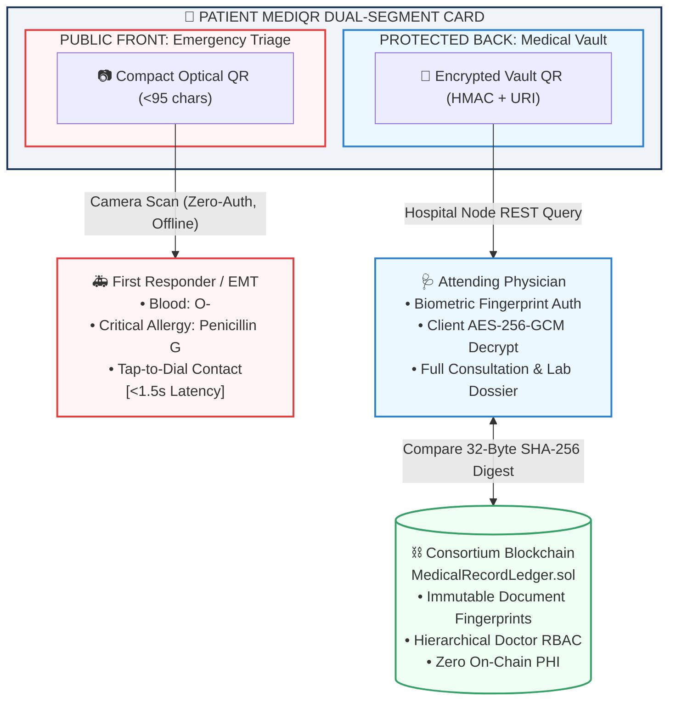
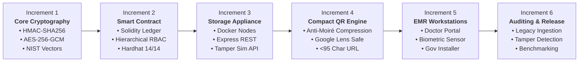
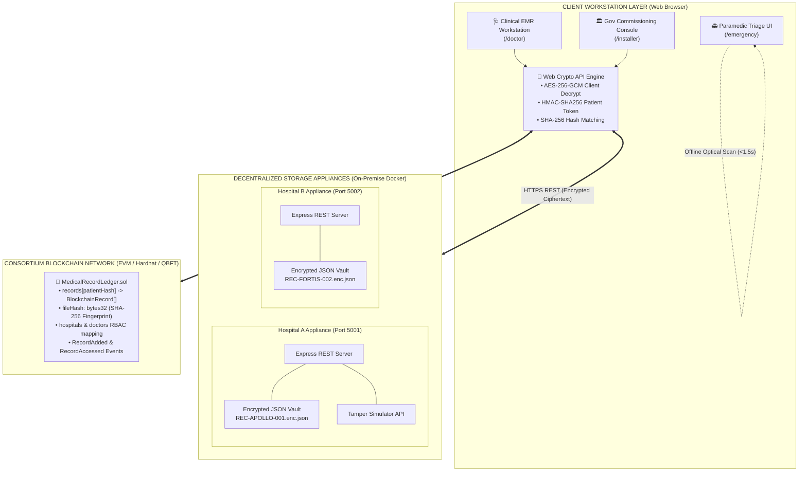
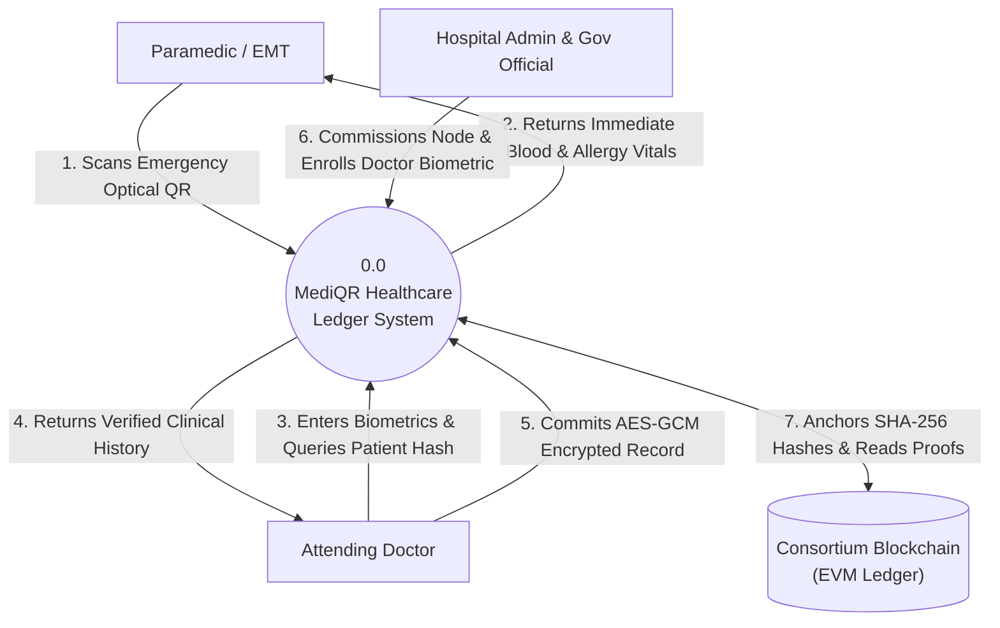
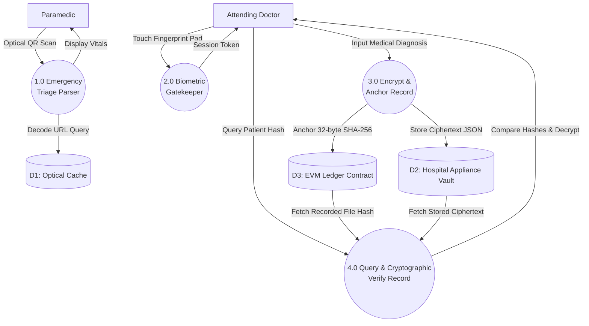
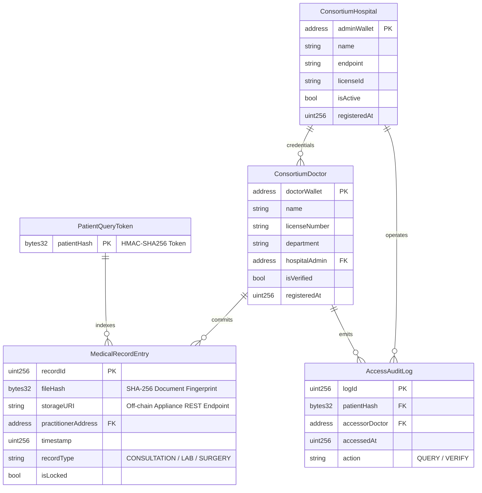
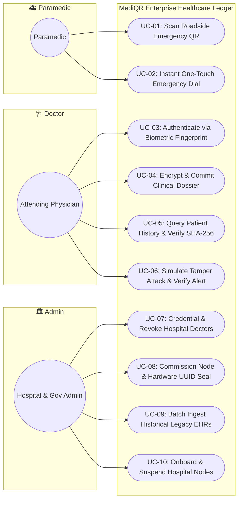
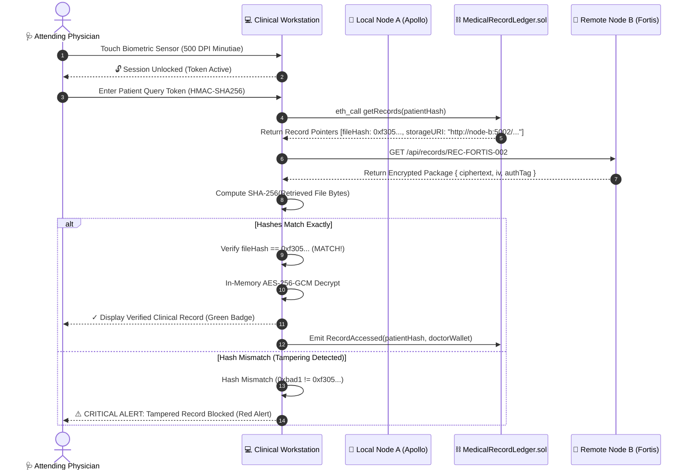
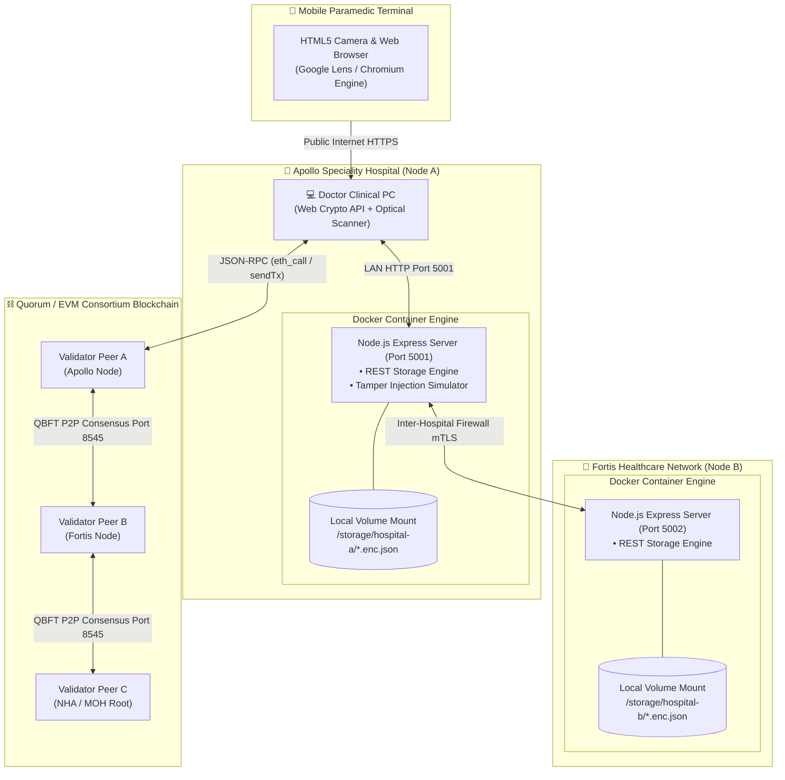
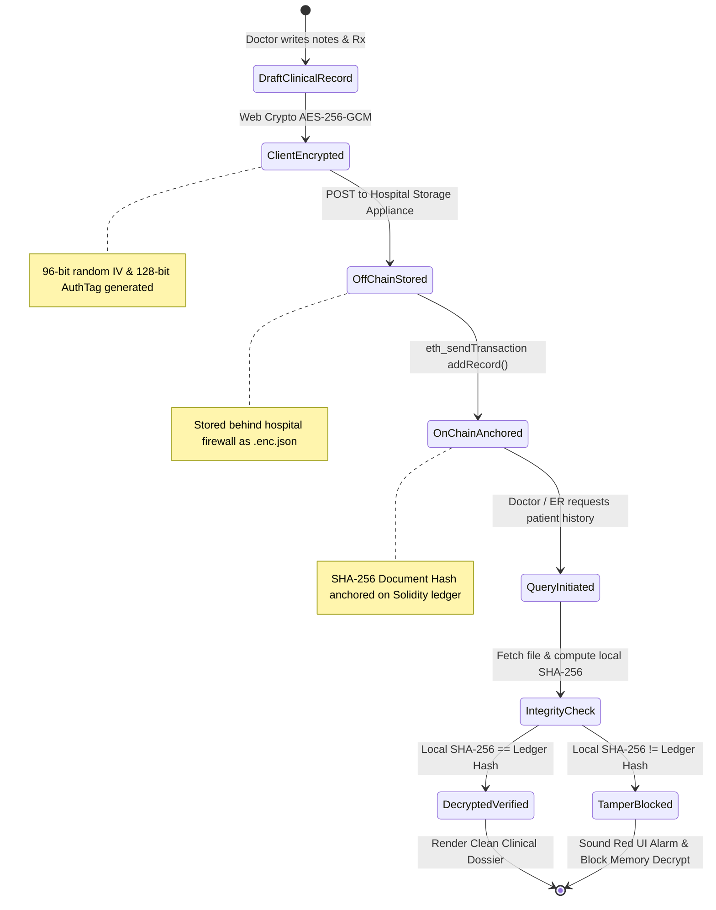

# 🎨 MediQR Project Report: Comprehensive Diagram Generation Prompts

This document provides ready-to-use prompts for generating all figures in the **MediQR Engineering Project Report**. You can use these in **ChatGPT (GPT-4o / DALL-E 3)**, **Eraser.io**, **Draw.io**, **PlantUML**, or directly render the provided **Mermaid.js** code blocks in Markdown viewers.

---

## 📌 Figure 1.1: High-Level View of the MediQR Ecosystem

### 🤖 AI Image / Diagram Generation Prompt (ChatGPT / Eraser.io / Midjourney):
```text
Create a clean, professional, high-resolution software architecture diagram for an enterprise healthcare blockchain project called "MediQR".
Layout is split horizontally:
At the top, a physical "MediQR Smart Card" divided into two sections:
1. Left: "Public Front: Emergency Triage" with an optical QR code icon, pointing downwards to an ambulance paramedic holding a smartphone displaying: "Blood Group: O-", "Allergy: Penicillin G", "Emergency Call Mom". Label: "Offline Instant Access (<1.5s, No Login)".
2. Right: "Protected Back: Medical Vault" with an encrypted QR icon, pointing downwards to an "Attending Physician" at a hospital terminal with a biometric fingerprint icon and blue key: "AES-256-GCM Decryption", "Full Clinical Dossier".
At the bottom, an immutable "Consortium Blockchain Ledger" (Ethereum EVM smart contract MedicalRecordLedger.sol) showing digital wax seals with 32-byte SHA-256 fingerprints: "0xf305...3d72" and "Hierarchical Doctor RBAC". An arrow connects the physician's verified hash to the blockchain with a green checkmark: "✓ Hash Matched (Tamper-Proof Provenance)".
Color palette: Professional medical navy blue, emerald green, crisp white background, modern flat vector design, clean tech diagram style.
```

### 💻 Mermaid Code:


---

## 📌 Figure 3.1: Incremental Process Model Applied to This Project

### 🤖 AI Prompt:
```text
A professional horizontal sequential pipeline diagram representing the Incremental Software Development Life Cycle (SDLC) for a blockchain healthcare project.
Six sequential rectangular boxes linked with thick forward arrows:
1. "Increment 1: Core Cryptography & NIST Vectors (HMAC-SHA256, AES-256-GCM, SHA-256)"
2. "Increment 2: Smart Contract Ledger (MedicalRecordLedger.sol, Hierarchical RBAC, Hardhat 14/14)"
3. "Increment 3: Off-Chain Storage Appliances (Docker Containers, Express REST, Tamper Simulation API)"
4. "Increment 4: Compact Optical QR Engine (Anti-Moiré Compression, Google Lens <20ms Parsing)"
5. "Increment 5: Clinical Workstations & Decoupling (Doctor Terminal, Biometric Gatekeeper, Gov Installer)"
6. "Increment 6: Integration & Auditing (Bulk Legacy Ingestion, Automated Security & Tamper Proofing)"
Clean corporate tech style, white background, subtle gradients of blue and teal.
```

### 💻 Mermaid Code:


---

## 📌 Figure 4.1: System Architecture (Client, Storage Appliance, On-Chain Contract)

### 🤖 AI Prompt:
```text
A detailed three-tier enterprise software architecture diagram for "MediQR":
1. Top Tier (Client Workstation Layer in Browser):
   - "Emergency Paramedic Triage UI (/emergency)"
   - "Doctor Clinical EMR Workstation (/doctor) with Biometric Sensor"
   - "Government Appliance Installer (/installer)"
   - "W3C Web Cryptography API Engine (AES-256-GCM + HMAC-SHA256)"
2. Middle Tier (Decentralized Hospital Storage Appliances):
   - Two Docker containers: "Hospital Node A (Apollo - Port 5001)" and "Hospital Node B (Fortis - Port 5002)"
   - Inside each container: "Express REST Engine", "Encrypted JSON File Vault", "Tamper Injection Simulator"
3. Bottom Tier (Consortium Blockchain Network):
   - "EVM Smart Contract: MedicalRecordLedger.sol"
   - Features: "32-byte SHA-256 Document Hashes", "Hierarchical RBAC", "Non-repudiable Access Logs", "Zero-Gas QBFT Consensus"
Connect layers with labeled directional arrows: HTTPS Encrypted REST between Client and Hospital Nodes; Signed JSON-RPC between Client and Blockchain.
Clean flat architectural vector illustration, blue and cyan accents, white background.
```

### 💻 Mermaid Code:


---

## 📌 Figure 4.2, 4.3, 4.4: Data Flow Diagrams (Level 0, Level 1, Level 2)

### 💻 Mermaid Code for Level 0 DFD (Context Diagram):


### 💻 Mermaid Code for Level 1 DFD:


---

## 📌 Figure 4.5: On-Chain Data Model (Entity-Relationship)

### 💻 Mermaid Code:


---

## 📌 Figure 4.6: UML Use Case Diagram

### 💻 Mermaid Code:


---

## 📌 Figure 4.7: UML Sequence Diagram (Cross-Hospital Verification Flow)

### 💻 Mermaid Code:


---

## 📌 Figure 4.10: UML Deployment Diagram

### 💻 Mermaid Code:


---

## 📌 Figure 4.11: State Machine Diagram (Record Lifecycle & Tamper Rejection)

### 💻 Mermaid Code:


---

## 📌 Figure 8.1: Benchmarking Charts

### 🤖 AI Prompt (For DALL-E / Midjourney / Canva):
```text
A clean corporate benchmark chart comparing three healthcare architectures:
Chart 1 (Bar Chart): "Emergency Triage Retrieval Latency (Seconds)"
- Centralized EHR (Epic/FHIR): 900 seconds (15 minutes) [Grey bar]
- Academic On-Chain Blockchain: 45 seconds [Orange bar]
- MediQR Enterprise: 1.5 seconds [Emerald Green bar]
Chart 2 (Bar Chart): "Tamper Detection Rate (%)"
- Centralized EHR: 0% (Silent database rewrite) [Red bar]
- MediQR Enterprise: 100% (Guaranteed cryptographic block) [Emerald Green bar]
Chart 3 (Bar Chart): "Transaction Gas Cost per Medical Record ($ USD)"
- Public Ethereum L1: $24.50 [Red bar]
- MediQR QBFT Consortium: $0.00 (Zero-Gas Medical Infrastructure) [Emerald Green bar]
Modern scientific presentation, clean typography, white background.
```

---

## 💡 How to Insert These Into Word (`MediQR_Final_Project_Report.docx`):
1. **Option A (Mermaid Live Editor)**: Copy any of the Mermaid code blocks above, paste into [mermaid.live](https://mermaid.live), click **Download PNG / SVG**, and insert directly into the Word document at the corresponding figure placeholder.
2. **Option B (Eraser.io / Draw.io)**: Paste the AI prompts or Mermaid code into Eraser.io or Draw.io to generate presentation-grade diagrams with custom hospital and blockchain icons.
3. **Option C (Direct Screenshot Capture)**: Run `npm run dev:portal` and capture live screenshots of `http://localhost:3000/emergency`, `http://localhost:3000/doctor`, and `http://localhost:3000/installer` to place into Figures 8.2, 8.3, and 8.4!
