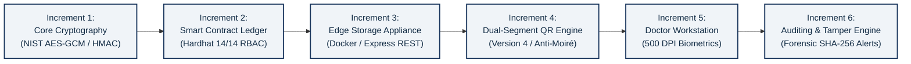
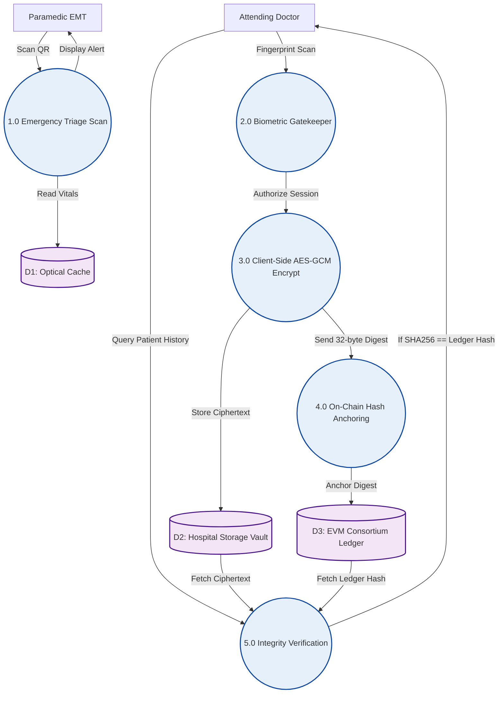
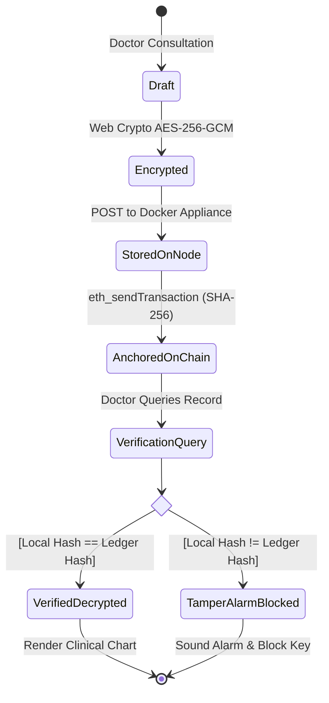

# 🎨 MediQR Project Report: Diagram Generation Prompts (All Placeholders)

This document contains **ready-to-use prompts** for generating every placeholder diagram in your project report. You can paste these prompts into **ChatGPT (GPT-4o / DALL-E 3)**, **Midjourney**, **Eraser.io**, or **Draw.io**. 

For technical diagrams (Flowcharts, DFD, Sequence, State, and Architecture), **Mermaid.js code** is also provided so you can render pixel-perfect diagrams in 5 seconds via [Mermaid Live Editor](https://mermaid.live) or Eraser.io.

> **💡 How Auto-Embedding Works:**
> Whenever you generate an image, save it into the `images/` folder using the suggested filename (or any filename starting with `Figure X.X`).
> Then run in PowerShell:
> ```powershell
> python generate_mediqr_report.py
> ```
> The script will immediately detect the image and embed it into `MediQR_Final_Project_Report.docx`.

---

## 📋 Status Overview of Report Diagrams

| Fig # | Title & Description | Relevant Academic Citations | Status | Target Filename |
|:---:|:---|:---:|:---:|:---|
| **1.1** | High-Level System Architecture | `[1], [12], [15]` | ✅ **Embedded** | `Figure 1.1 High-Level System Architecture.png` |
| **3.1** | Incremental SDLC Engineering Process Model | `[8], [9]` | ⏳ *Placeholder* | `Figure 3.1 Incremental software engineering SDLC process model.png` |
| **4.1** | 3-Tier Decoupled System Architecture | `[2], [5], [10]` | ✅ **Embedded** | `Figure 4.1 System Architecture (3-Tier Decoupled Pipeline).png` |
| **4.2** | Context-Level Data Flow Diagram (Level 0 DFD) | `[1], [6], [14]` | ⏳ *Placeholder* | `Figure 4.2 Context-level data flow diagram Level 0.png` |
| **4.3** | Data Flow Diagram Level 1 (Clinical Workflows) | `[7], [11], [12]` | ⏳ *Placeholder* | `Figure 4.3 Data flow diagram Level 1.png` |
| **4.4** | Data Flow Diagram Level 2 (Record Push Pipeline) | `[11], [15]` | ⏳ *Placeholder* | `Figure 4.4 Data flow diagram Level 2.png` |
| **4.5** | On-Chain & Off-Chain Data Model (ER Diagram) | `[3], [13]` | ⏳ *Placeholder* | `Figure 4.5 On-chain and off-chain data model ER diagram.png` |
| **4.6** | UML Use Case Diagram (Actors & RBAC Boundary) | `[2], [7]` | ✅ **Embedded** | `Figure 4.6 UML Use Case Diagram.png` |
| **4.7** | UML Sequence Diagram (Cross-Hospital Verification) | `[6], [8]` | ✅ **Embedded** | `Figure 4.7 UML Sequence Diagram (Cross-Hospital Verification).png` |
| **4.8** | UML Class and Module Structural Diagram | `[4], [11]` | ⏳ *Placeholder* | `Figure 4.8 UML class and module structural diagram.png` |
| **4.9** | UML Component Diagram | `[5], [10]` | ⏳ *Placeholder* | `Figure 4.9 UML component diagram.png` |
| **4.10** | UML Deployment Diagram | `[5], [8]` | ⏳ *Placeholder* | `Figure 4.10 UML deployment diagram.png` |
| **4.11** | UML State Machine Diagram (Record Lifecycle) | `[7], [8]` | ⏳ *Placeholder* | `Figure 4.11 UML state machine diagram.png` |
| **5.1** | 12-Week Project Timeline (Gantt Chart) | — | ⏳ *Placeholder* | `Figure 5.1 Project timeline Gantt chart.png` |
| **8.1** | Benchmarking Visual Charts (Throughput & Latency) | `[12], [14]` | ✅ **Embedded** | `Figure 8.1 Benchmarking Visual Charts.png` |
| **8.2** | Screen Shot: Emergency Triage Mobile Interface | `[12], [14]` | ⏳ *Placeholder* | `Figure 8.2 Screen shot roadside emergency triage terminal.png` |
| **8.3** | Screen Shot: Doctor Workstation with Biometrics | `[2], [7]` | ⏳ *Placeholder* | `Figure 8.3 Screen shot doctor clinical workstation.png` |
| **8.4** | Screen Shot: Government Commissioning & Tamper Alarm | `[1], [11]` | ⏳ *Placeholder* | `Figure 8.4 Screen shot government commissioning appliance.png` |

---

# 🎨 Prompts for All Placeholder Diagrams

---

### 1. Figure 3.1: Incremental Software Engineering SDLC Process Model
* **Filename to save in `images/`:** `Figure 3.1 Incremental software engineering SDLC process model.png`
* **Academic Citations:** Vazirani et al. [8], Shahnaz et al. [9]
* **AI Image Generator Prompt (ChatGPT / DALL-E / Midjourney):**
```text
A professional horizontal software engineering process flow diagram illustrating the "Incremental SDLC Process Model" for an enterprise healthcare blockchain system called MediQR.
Show 6 sequential rectangular increment stages linked from left to right with crisp chevron arrows on a clean white background:
- Stage 1: "Increment 1: Core Cryptography & NIST Vectors" (Subtext: HMAC-SHA256, AES-256-GCM, SHA-256 Digest Validation)
- Stage 2: "Increment 2: Smart Contract Ledger" (Subtext: MedicalRecordLedger.sol, Hierarchical RBAC, Hardhat 14/14 Tests)
- Stage 3: "Increment 3: Edge Storage Appliances" (Subtext: Docker Microservices, Isolated Volume Vaults, Tamper API)
- Stage 4: "Increment 4: Dual-Segment QR Engine" (Subtext: Anti-Moiré URL Compression <95 chars, Google Lens Safe)
- Stage 5: "Increment 5: Clinical Workstation & Biometrics" (Subtext: Doctor EMR Portal, 500 DPI Fingerprint Gatekeeper)
- Stage 6: "Increment 6: Auditing & Forensic Penetration" (Subtext: Single-bit Tamper Injection, 100% Assertion Suite)
Style: Modern academic technical flowchart, high contrast, subtle blue and slate-grey color palette, crisp vector typography, 16:9 ratio.
```
* **Mermaid Code (Alternative instant render):**


---

### 2. Figure 4.2: Context-Level Data Flow Diagram (Level 0 DFD)
* **Filename to save in `images/`:** `Figure 4.2 Context-level data flow diagram Level 0.png`
* **Academic Citations:** Ekblaw et al. [1], Zhang et al. [6], HL7 FHIR [14]
* **AI Image Generator Prompt (ChatGPT / DALL-E / Draw.io):**
```text
A formal Context-Level Data Flow Diagram (Level 0 DFD) for "MediQR Healthcare Ledger System".
In the center, a large circle labeled: "0.0 MediQR Healthcare Archive & Triage Ledger".
Surrounding the central circle, four distinct external entity rectangles with clear directional data flow arrows:
1. Top Entity: "First Responder / EMT Paramedic"
   - Inward arrow: "Scans Optical Triage QR Code"
   - Outward arrow: "Receives Immediate Blood Group & Critical Allergy Vitals"
2. Left Entity: "Attending Clinical Physician"
   - Inward arrow: "Submits 500 DPI Biometric Auth & Encrypted Consultation"
   - Outward arrow: "Receives Decrypted Longitudinal Medical Dossier"
3. Bottom Entity: "Consortium Blockchain Network (EVM Smart Contract)"
   - Inward arrow: "Anchors 32-Byte SHA-256 Record Hashes (eth_sendTransaction)"
   - Outward arrow: "Returns Immutable Provenance Hashes & RBAC Permissions"
4. Right Entity: "Hospital Admin & Government Official"
   - Inward arrow: "Commission Node, Bind Hardware UUID & Enroll Doctor Biometrics"
   - Outward arrow: "Receives Cryptographic Audit Receipts"
Style: Formal IEEE software engineering schematic, crisp black outlines, light grey fills, clean white background, perfectly legible text.
```

---

### 3. Figure 4.3: Data Flow Diagram, Level 1 (Clinical Workflows)
* **Filename to save in `images/`:** `Figure 4.3 Data flow diagram Level 1.png`
* **Academic Citations:** Dagher et al. [7], NIST SP 800-38D [11], ISO/IEC 18004 [12]
* **AI Image Generator Prompt:**
```text
A formal Level 1 Data Flow Diagram (Level 1 DFD) showing 5 interconnected processes (numbered circles) and 3 data stores (open parallel horizontal lines):
Processes:
- (1.0) "Emergency Triage Optical Scan & Parse"
- (2.0) "Doctor Biometric Authentication Gatekeeper"
- (3.0) "Client-Side In-Memory AES-256-GCM Encryption"
- (4.0) "On-Chain SHA-256 Fingerprint Anchoring"
- (5.0) "Integrity Verification & Ledger Hash Matching"
Data Stores:
- [D1: Optical Cache (Front QR Parameters)]
- [D2: Hospital Appliance Encrypted Vault (.enc.json)]
- [D3: EVM Consortium Smart Contract (MedicalRecordLedger)]
Show directed arrows connecting Actors (Paramedic, Attending Doctor) through these processes and data stores.
Clean academic engineering schematic, white background, high contrast, crisp lines.
```
* **Mermaid Code:**


---

### 4. Figure 4.4: Data Flow Diagram, Level 2 (Record Push Pipeline)
* **Filename to save in `images/`:** `Figure 4.4 Data flow diagram Level 2.png`
* **Academic Citations:** NIST SP 800-38D [11], DPDP Act 2023 [15]
* **AI Image Generator Prompt:**
```text
A detailed Level 2 Data Flow Diagram (Level 2 DFD) expanding the "Record Push & Encryption Process" into 6 sequential sub-processes (circles) connected in a clear pipeline:
1. (3.1) "Generate 96-bit Cryptographic Random IV"
2. (3.2) "Execute Client-Side AES-256-GCM Encryption over Clinical Payload"
3. (3.3) "Generate 128-bit Authentication Tag & Package Ciphertext"
4. (3.4) "Compute 32-byte SHA-256 Hash of Complete Stored Package"
5. (3.5) "Store Encrypted Payload to Local Hospital Storage Appliance (Node A)"
6. (3.6) "Dispatch Signed JSON-RPC eth_sendTransaction to Anchor File Hash on Smart Contract"
Data store outputs: [D2: Appliance Filesystem Vault] and [D3: On-Chain Ledger State].
Clear, elegant software engineering DFD diagram, white background, black lines.
```

---

### 5. Figure 4.5: On-Chain & Off-Chain Data Model (Entity-Relationship Diagram)
* **Filename to save in `images/`:** `Figure 4.5 On-chain and off-chain data model ER diagram.png`
* **Academic Citations:** Dubovitskaya et al. [3], W3C DID [13]
* **AI Image Generator Prompt:**
```text
A professional Entity-Relationship (ER) Diagram representing the hybrid on-chain and off-chain data model of MediQR.
Show 5 entity tables with primary keys (PK), foreign keys (FK), and attribute data types:
1. "ConsortiumHospital"
   - adminWallet (PK, address)
   - name (string), endpoint (string), licenseId (string), isActive (bool), registeredAt (uint256)
2. "ConsortiumDoctor"
   - doctorWallet (PK, address)
   - name (string), licenseNumber (string), department (string), hospitalAdmin (FK, address), isVerified (bool)
   - Relationship: Hospital 1 to Many Doctor (credentials)
3. "PatientQueryToken"
   - patientHash (PK, bytes32 HMAC-SHA256 token)
4. "MedicalRecordEntry"
   - recordId (PK, uint256), fileHash (bytes32 SHA-256 digest), storageURI (string), practitionerAddress (FK, address), timestamp (uint256), recordType (string), isLocked (bool)
   - Relationship: PatientQueryToken 1 to Many MedicalRecordEntry
   - Relationship: Doctor 1 to Many MedicalRecordEntry (commits)
5. "AccessAuditLog"
   - logId (PK, uint256), patientHash (FK, bytes32), accessorDoctor (FK, address), accessedAt (uint256)
Modern crows-foot ER diagram notation, crisp borders, dark blue headers, white background.
```

---

### 6. Figure 4.8: UML Class and Module Structural Diagram
* **Filename to save in `images/`:** `Figure 4.8 UML class and module structural diagram.png`
* **Academic Citations:** Yue et al. [4], NIST SP 800-38D [11]
* **AI Image Generator Prompt:**
```text
A formal UML Class / Module Diagram for the MediQR healthcare cryptography and blockchain engine:
Show 5 class boxes with private attributes (-) and public methods (+):
1. "CryptoEngineService"
   - masterSalt: string
   + hashPatientId(id: string, salt: string): bytes32
   + encryptRecord(payload: RecordPayload, key: CryptoKey): EncryptedPackage
   + decryptRecord(cipher: string, iv: string, tag: string): RecordPayload
   + computeFileHash(buffer: ArrayBuffer): bytes32
2. "BlockchainLedgerService"
   - contractAddress: address, rpcProvider: JsonRpcProvider
   + getPatientRecords(patientHash: bytes32): RecordPointer[]
   + addRecord(fileHash: bytes32, uri: string, recordType: string): TxReceipt
   + onboardHospital(admin: address, name: string): TxReceipt
   + registerDoctor(doctor: address, name: string): TxReceipt
3. "DoctorWorkstationController"
   - activeDoctor: address, isBiometricUnlocked: boolean
   + handleBiometricAuthentication(): void
   + verifyAndDecryptRecord(uri: string, expectedHash: bytes32): VerificationReport
4. "EmergencyTriageParser"
   + parseCompactUrl(queryString: string): TriageVitals
   + decodeOfflinePayload(raw: string): TriageData
5. "StorageApplianceClient"
   + uploadRecord(encryptedJson: string): string
   + fetchRecord(uri: string): EncryptedPackage
Show dependency and association arrows between modules. Clean UML notation, white background.
```

---

### 7. Figure 4.9: UML Component Diagram
* **Filename to save in `images/`:** `Figure 4.9 UML component diagram.png`
* **Academic Citations:** Esposito et al. [5], Abbas et al. [10]
* **AI Image Generator Prompt:**
```text
A formal UML 2.0 Component Diagram for "MediQR":
Enclosing subsystem: "Next.js Web Client Application" containing:
- Component 1: "<<component>> Emergency Triage Module (/emergency)"
- Component 2: "<<component>> Doctor Clinical Workstation (/doctor)"
- Component 3: "<<component>> Government Commissioning Utility (/installer)"
- Component 4: "<<component>> Core Cryptography Engine (Web Crypto API, AES-256-GCM, HMAC)"
External components connected via interfaces (lollipop / socket connectors):
- Component 5: "<<component>> Hospital Storage Appliance (Docker REST Port 5001)" connected via REST HTTPS
- Component 6: "<<component>> Consortium Blockchain Validator (Hardhat / QBFT EVM Node)" connected via JSON-RPC 2.0
Clean structural component diagram, standard UML 2.0 component box icons with two small tabs on the left edge, white background.
```

---

### 8. Figure 4.10: UML Deployment Diagram
* **Filename to save in `images/`:** `Figure 4.10 UML deployment diagram.png`
* **Academic Citations:** Esposito et al. [5], Vazirani et al. [8]
* **AI Image Generator Prompt:**
```text
A formal UML 3D-box Deployment Diagram showing distributed nodes and physical hardware execution:
1. Node: "<<device>> Paramedic Mobile Smartphone (Android / iOS)"
   - Artifact: "Mobile Web Browser (Google Lens / Chrome OCR)"
2. Node: "<<device>> Hospital A On-Premise Server (Dell PowerEdge R740)"
   - Environment: "<<executionEnvironment>> Docker Engine"
   - Artifact: "hospital-node-a:5001 Express Container"
   - Storage Volume: "<<storage>> /storage/hospital-a/*.enc.json"
3. Node: "<<device>> Hospital B On-Premise Server"
   - Environment: "<<executionEnvironment>> Docker Engine"
   - Artifact: "hospital-node-b:5002 Express Container"
4. Node: "<<device>> Consortium Blockchain EVM Peer Network"
   - Node 1: "Apollo Validator Peer (Port 8545)"
   - Node 2: "Fortis Validator Peer (Port 8545)"
   - Node 3: "Ministry of Health (MOH) Root Validator"
   - Connected via P2P QBFT Consensus.
Show network protocols: HTTPS (Port 443), Local REST (Port 5001), JSON-RPC (Port 8545).
```

---

### 9. Figure 4.11: UML State Machine Diagram (Record Lifecycle & Tamper Rejection)
* **Filename to save in `images/`:** `Figure 4.11 UML state machine diagram.png`
* **Academic Citations:** Dagher et al. [7], Vazirani et al. [8]
* **AI Image Generator Prompt:**
```text
A formal UML State Machine Diagram showing the lifecycle of a medical record:
States (rounded rectangles):
- [Initial State: (*)]
- [1. Draft Consultation] -> Trigger: Doctor writes diagnosis & prescription
- [2. Client-Side AES-256-GCM Encrypted] -> Trigger: Browser Web Crypto API generates IV & AuthTag
- [3. Stored On Appliance] -> Trigger: POST ciphertext to Hospital Storage Node
- [4. Anchored On Ledger] -> Trigger: eth_sendTransaction records 32-byte SHA-256 hash on smart contract
- [5. Integrity Verification] -> Trigger: Attending Doctor queries record
Decision branch:
- State [6A: Verified & In-Memory Decrypted] (Green outline) if Local SHA-256 == Ledger Hash -> Render Patient Chart
- State [6B: Critical Tamper Alert Blocked] (Red outline) if Local SHA-256 != Ledger Hash -> Sound Red UI Alarm
- [Final State: (*)]
Clean UML state transitions with arrows, guard conditions in brackets [ ], white background.
```
* **Mermaid Code:**


---

### 10. Figure 5.1: 12-Week Project Timeline (Gantt Chart)
* **Filename to save in `images/`:** `Figure 5.1 Project timeline Gantt chart.png`
* **AI Image Generator Prompt:**
```text
A professional horizontal Gantt Chart for a 12-week software engineering project (Week 1 to Week 12).
Horizontal bars across 8 project tasks:
1. "T1: Domain Analysis & Statutory SRS" (Weeks 1 - 2) [Blue bar]
2. "T2: Core Cryptography & NIST Vectors" (Weeks 2 - 4) [Blue bar]
3. "T3: Smart Contract & Hardhat Tests" (Weeks 4 - 6) [Teal bar]
4. "T4: Docker Storage Node Appliance" (Weeks 6 - 7) [Teal bar]
5. "T5: Dual-Segment QR Engine & Paramedic Scanner" (Weeks 7 - 8) [Green bar]
6. "T6: Clinical Workstation & Biometrics" (Weeks 8 - 10) [Green bar]
7. "T7: Gov Installer & Legacy Migration" (Weeks 10 - 11) [Orange bar]
8. "T8: Auditing, Benchmarks & Final Documentation" (Weeks 11 - 12) [Purple bar]
Clear weekly grid lines from W1 to W12, clean professional corporate layout, white background.
```

---

### 11. Figures 8.2, 8.3, 8.4: Screen Shots & User Workflows
* **Academic Citations:** ISO/IEC 18004 [12], HL7 FHIR [14], Kuo et al. [2], Ekblaw et al. [1], NIST SP 800-38D [11]
* **How to Capture Real Screenshots from your live project:**
  1. Open your terminal in `doctor-portal/` and start your development server:
     ```powershell
     npm run dev:portal
     ```
  2. **Figure 8.2**: Navigate to `http://localhost:3000/emergency` on your mobile viewport or browser. Take a screenshot showing the red emergency triage banner, blood group O-, and allergy alert. Save as `Figure 8.2 Screen shot roadside emergency triage terminal.png`.
  3. **Figure 8.3**: Navigate to `http://localhost:3000/doctor`. Take a screenshot showing the doctor profile, the green "✓ Blockchain Verified" badge, and the decrypted EMR chart. Save as `Figure 8.3 Screen shot doctor clinical workstation.png`.
  4. **Figure 8.4**: Navigate to `http://localhost:3000/installer`. Take a screenshot of the Government Official Commissioning console and the forensic tamper detection test. Save as `Figure 8.4 Screen shot government commissioning appliance.png`.
* **Alternatively (AI Mockup Prompt if you want synthetic UI mockups):**
```text
Three clean, modern high-fidelity web UI screenshots for an enterprise medical application:
1. "Roadside Emergency Triage Terminal": Mobile viewport showing a high-visibility red alert banner, bold "BLOOD GROUP: O-NEGATIVE", yellow badge "ANAPHYLACTIC ALLERGY: PENICILLIN G", and a green button "Dial Emergency ICE Contact: +91 98220 12345".
2. "Doctor Clinical Workstation": Clean clinical dashboard with Dr. John Doe profile, a green pill badge "✓ Blockchain Verified (SHA-256 Matched)", prescription history, and biometric fingerprint status unlocked.
3. "Government Health Authority Commissioning Console": Dark-mode administrative dashboard showing Ministry of Health emblem, Hardware UUID binding card, and a glowing red warning box "FORENSIC TAMPER ALERT: Single-bit alteration detected at offset 0x4B2; Ledger mismatch halts decryption".
Modern software UI, flat design, crisp typography, white background.
```

---

## 🚀 Quick Regeneration Command
Once you save any of the images above into `images/`:
```powershell
python generate_mediqr_report.py
```
Your report at `MediQR_Final_Project_Report.docx` will instantly embed the graphic in place of the placeholder box!
